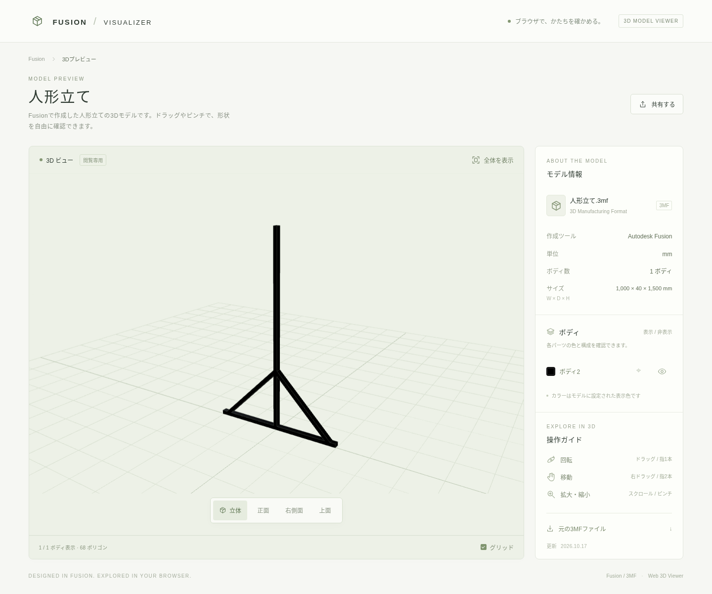

# Fusion 3Dビューア

Fusion から書き出した 3MF を、スマートフォンや PC のブラウザで確認する静的ビューアです。Three.js・TypeScript・Vite を使用し、GitHub Pages で公開しています。閲覧にログインは不要です。

**公開サイト:** https://kenken49-2401.github.io/fusion-visualizer1/

**制作手順アプリのPC編集版:** [Windows用ZIPをダウンロード](https://kenken49-2401.github.io/fusion-visualizer1/downloads/fusion-editor-windows.zip)して展開し、`Start-Editor.cmd` をダブルクリックします。Node.js 24 LTS 以降が必要です。以後は起動時にGitHub上のアプリの更新を取り込みます。[詳しい起動・更新方法](assembly-guide/README.md#windowsで簡単に起動自動更新)を参照してください。



[スマートフォン表示例](docs/preview-mobile.png)

公開画面ではモデルの切り替え、回転・拡大縮小・視点変更、ボディの選択と表示切り替え、寸法図、2点間の測定ができます。公開色の編集はローカルの管理用開発サーバーで行います。一般の3Dモデルをアップロードする機能や、形状を編集する機能はありません。

## 5つのモデルを選ぶ

「モデルを選択」から切り替えられます。選択したモデルは URL の `?model=` に反映され、そのリンクを共有できます。

| モデル / リンク | ボディ数 | 三角形数 | 幅 × 奥行 × 高さ（mm） |
| --- | ---: | ---: | --- |
| [人形立て](https://kenken49-2401.github.io/fusion-visualizer1/?model=figure-stand) | 1 | 68 | 1000 × 40 × 1500 |
| [柱装飾](https://kenken49-2401.github.io/fusion-visualizer1/?model=pillar-decoration) | 4 | 348 | 975 × 845 × 1990 |
| [サイネージ](https://kenken49-2401.github.io/fusion-visualizer1/?model=signage) | 31 | 1876 | 940 × 930 × 2141.86 |
| [立ち机 大](https://kenken49-2401.github.io/fusion-visualizer1/?model=standing-desk-large) | 19 | 308 | 2300 × 880 × 980 |
| [立ち机 小](https://kenken49-2401.github.io/fusion-visualizer1/?model=standing-desk-small) | 13 | 428 | 1820 × 910 × 992 |

同じ名前のボディは画面上で番号を付けて区別します。寸法は配置・向きを反映したメッシュの外接寸法です。人形立ての元データは X / Y / Z が 40 / 1000 / 1500 mm、上方向 Z・正面方向 X、ボディ `ボディ2` の ID は `build:0/object:1` です。柱装飾とサイネージは上方向 Z・正面方向 Y です。

一覧は `public/catalog.json`、各モデルの設定は次のファイルで管理します。パスはリポジトリ直下からのものです。

| モデル ID | 設定 | 3MF |
| --- | --- | --- |
| `figure-stand` | `public/viewer.json` | `public/models/figure-stand.3mf` |
| `pillar-decoration` | `public/models/pillar-decoration.json` | `public/models/pillar-decoration.3mf` |
| `signage` | `public/models/signage.json` | `public/models/signage.3mf` |
| `standing-desk-large` | `public/models/standing-desk-large.json` | `public/models/standing-desk-large.3mf` |
| `standing-desk-small` | `public/models/standing-desk-small.json` | `public/models/standing-desk-small.3mf` |

## ボディをグループ化する

ローカルの編集画面から、複数のボディを選んで名前付きグループを作成できます。名前・所属ボディの変更、グループの削除、一括での色変更に対応します。「設定を保存」でモデルの設定JSONへ保存し、「GitHubへ同期」で公開へ反映します。グループだけの保存では3MF本体を変更しません。

公開の閲覧画面では、保存されたグループのボディをまとめて表示・非表示にしたり、グループへ視点を寄せたりできます。グループの作成・編集は開発者用のローカル画面だけで行います。

グループはボディの名前ではなく3MF由来のIDを参照します。同名の部品も個別に選択でき、1つのボディは1つのグループに所属します。グループの削除で元のボディは削除しません。形状の結合・変形・移動は行わず、未登録のモデルに自動でグループを推測する機能もありません。

## 寸法付き図面

キャンバス付近の「寸法付き図面」またはサイドバーの「図面・部品寸法を見る」を押すと、SVG 図面と全ボディの幅・奥行・高さの一覧が開きます。「方向」から正面（前）・背面（後）・左側面・右側面・上面・下面の6方向を選べます。反対側から見ると向きを反転し、選択中の辺と実長のラベルを保ちます。SVG 保存・印刷にも選んだ方向を反映します。3D画面で非表示にしたボディも図面・一覧の対象です。

図面の部品番号、「部品」、または一覧の番号からボディを選ぶと、その部品の寸法を確認できます。部品を選ぶと代表する辺の長さを表示し、図面の別の辺をタップ・クリックすると、選んだ辺と両端をオレンジ色で強調してすぐそばに長さを表示します。「辺の3D実長」からも選べます。一覧や辺の選択後は図面へ戻るため、数値と測定箇所を照合できます。

辺のラベルは斜材を含む空間内の実長です。外側の寸法線はその方向から見た投影幅・高さで、辺の実長とは区別して表示します。スマートフォンでも図面全体が横幅に収まります。「SVG保存」はラベル付きの現在の図を保存し、「印刷 / PDF」は図面と部品寸法一覧の印刷画面を開きます。PDF 保存はブラウザの印刷機能を使います。

図面・測定は 3MF メッシュに基づく近似です。曲面は線分で近似し、隠線処理は行いません。Fusion の BRep・履歴・拘束・公差を再現する製作用 CAD 図面ではなく、加工寸法の保証はありません。

## 2点間を測る

キャンバス付近の「2点間を測る」、またはサイドバー「距離を計測」の「計測を開始」を押し、モデル上の2点をタップ・クリックします。面上の点同士の3D距離を mm で表示します。「頂点にスナップ」を有効にすると、選択位置に近いメッシュ頂点へ合わせられます。ドラッグで視点を回しながら、複数の測定結果を残せます。

各結果の「削除」、「すべて削除」、「注釈を隠す」で整理できます。「選択を取消」は選択中の始点を取り消します。

測定結果は同じブラウザの `localStorage` にモデルの内容と向きごとに保存され、再読み込みやモデル切り替え後も復元されます。モデルファイルや向きが変わると別の測定対象になります。ブラウザの保存機能を利用できない場合はセッション中のみ保持します。測定結果は公開サイトや GitHub に同期されず、共有リンクにも含まれません。ブラウザのサイトデータを削除すると保存結果も消えます。

## 開発・検証

Node.js 24 を推奨します（Vite の要件は Node.js 22.12 以上）。アプリはリポジトリ直下にあります。

```sh
npm ci
npm run dev
```

開発サーバーは `127.0.0.1:5173` を使用します。通常閲覧と色編集のサーバーは同時起動せず、切り替えるときは先に終了してください。

```sh
npm test
npm run build
npm run preview
```

ビルド結果は `dist/`、プレビューのポートは `4173` です。ブラウザの自動テストは次のコマンドで実行します。

```sh
npx playwright install chromium
npm run test:e2e
```

これらは検証コマンドの案内です。Chromium のスマートフォン表示エミュレーションは、実機の iPhone Safari での動作確認とは異なります。iPhone Safari を主な対象としていますが、実機での最終確認は必要です。

## ローカルで色を保存する

書き込み権限のある管理者が手元のチェックアウトで実行します。

```sh
npm run dev:admin
```

1. モデルを選び、「色を編集（開発者用）」を開きます。
2. ボディの色をプレビューします。「読込時の色」は、そのページでモデルを読み込んだ時点の色に戻します。「変更を取り消す」は未保存の編集を取り消します。
3. 「設定を保存」を押すと、選択中の **3MF 本体に色を記録**します。3MF 内の材料・色の XML を更新し、形状は保持します。対応する設定ファイルの `colors` は空になり、保存前の 3MF は `.local/backups/` に残ります。
4. 公開へ反映する場合は、別操作の「GitHubへ同期」を押します。

保存後も、同じページを開いている間の「読込時の色」は最初に読み込んだ色です。再読み込み後は、保存済みの 3MF の色が新しい基準になります。過去の元ファイルが必要な場合は `.local/backups/` を使用してください。「設定ファイルをダウンロード」は JSON の控えで、3MF 本体のバックアップではありません。

同時編集でモデルや設定が更新されていた場合は保存を拒否します。ページを再読み込みし、最新状態を確認してから編集し直してください。

管理 UI と保存・同期用ルートはローカルの admin 開発モードだけで有効です。公開ビルドには編集モジュールも管理用ルートも含まれません。GitHub Pages の訪問者が元ファイルを書き換えることはできません。

## GitHub への同期と公開

「GitHubへ同期」は、インストール済みの Git と設定済みの認証を使用し、選択中のモデルの **3MF と設定ファイルだけ**をステージ・コミット・push します。HTTPS 接続では既存の Git 認証を使用します。Git のコミットユーザー設定と、対象リポジトリへ push できる認証が必要です。未保存の色変更がある間は同期できません。

別のファイルがすでにステージされている場合は同期を拒否します。そのステージを解除するか、別の作業としてコミットしてから再実行してください。同期先はこのリポジトリの `origin`、push 先は現在のブランチです。公開ワークフローを実行するには `main` に反映します。モデル一覧の追加など、選択中の2ファイル以外の変更は通常の Git 操作で反映してください。

同期では自動 pull や force push は行いません。リモート側が進んでいる場合は、通常の Git 操作で pull・競合解消を行い、画面を再読み込みしてから再実行してください。push に失敗しても、ローカルの保存やコミットが完了している場合があります。Git の状態を確認してください。

`.github/workflows/pages.yml` は `main` への push と手動実行に対応します。依存関係の固定インストール、ユニットテスト、ビルドを行い、成果物を Pages に配信します。プロジェクトサイトのパス `/<リポジトリ名>/` を `BASE_PATH` に渡します。カスタムドメインを使う場合は `/` に変更してください。push 成功後、Actions のデプロイ完了を確認すると公開サイトに反映されます。

別のリポジトリで公開する場合は、**Settings → Pages → Build and deployment → Source** を **GitHub Actions** に設定してください。ワークフローは Pages の自動有効化も試みますが、組織の方針や権限によって手動設定が必要です。

公開された HTML・JavaScript・設定・3MF は訪問者が取得できます。ダウンロードさせたくないモデルや機密情報は置かないでください。元ファイルへの変更を公開できるのは、リポジトリへの書き込み権限を持つ共同作業者です。

実行時の資産は同じ配信元から読み込み、外部 CDN、ログインサービス、Blender は不要です。開発依存関係の取得には npm レジストリを使用します。初回表示には通信が必要で、オフライン PWA ではありません。ライセンスは [public/third-party-licenses.txt](public/third-party-licenses.txt) に同梱しています。

## 更新と動作確認

モデル追加・差し替えは [docs/model-update.md](docs/model-update.md) を参照してください。公開前に、PC と実機の iPhone Safari で次を確認してください。

- 3つのモデルを切り替えられ、共有 URL を直接開いても正しいモデルが表示される。
- 回転・ピンチ・視点変更・ボディ選択と表示切り替えが動作し、幅・奥行・高さが意図した値になる。
- 寸法図の各方向・全ボディ一覧・部品選択・斜めの辺の実長、SVG 保存と印刷を確認できる。
- 2点間測定を複数残せ、回転・再読み込み・モデル切り替え後も適切に表示され、削除・注釈の表示切り替えができる。
- 縦向き・横向きで操作でき、公開サイトに色編集・保存・同期の UI がない。
