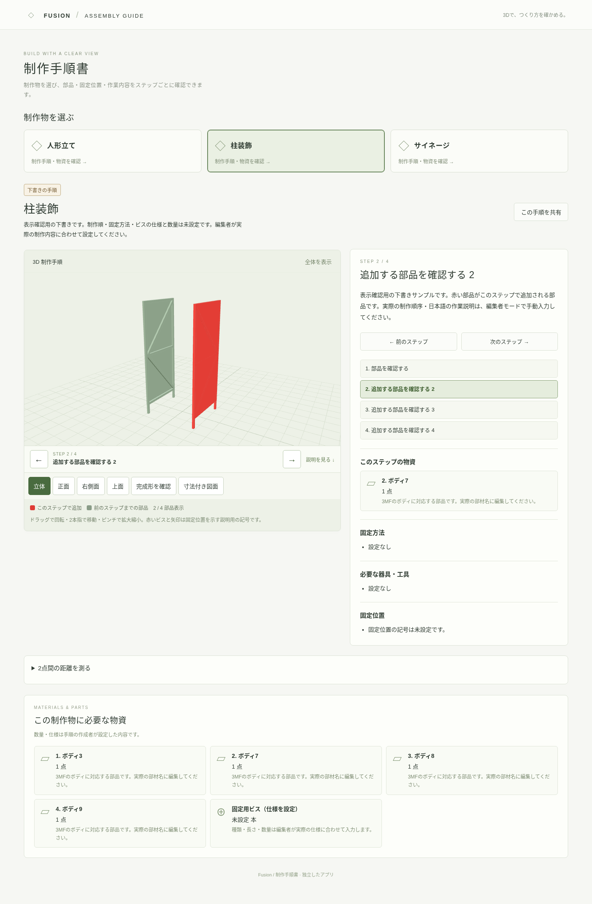

# 3D 制作手順書

元の Fusion ビューアを変更せずに作った、独立した制作手順アプリです。ソース・設定・3MF・手順データをこのフォルダ内に分けています。元のページは従来の URL のままで、新しいページは次の URL です。

https://kenken49-2401.github.io/fusion-visualizer1/assembly-guide/



## 閲覧できること

- 人形立て・柱装飾・サイネージから制作物を選択。
- ステップごとに日本語の説明を表示。前のステップまでの部品を残し、今回追加するボディを赤く表示。
- 制作物全体の物資・部材一覧、ステップごとの物資・使用数、固定方法、工具・器具を表示。物資は部材・ビス・工具などのアイコンを選べます。
- 固定する位置に赤いビス・矢印・位置の印を表示。固定位置一覧を押すと、その場所へ視点を寄せます。記号は説明用で、ビス頭や矢印の表示サイズは実寸を保証しません。
- 回転・移動・拡大縮小、完成形の確認、6方向の寸法図、2点間測定も利用できます。
- URL の `?product=pillar-decoration&step=2` で制作物とステップを共有できます。

付属の3制作物の手順は、表示確認用の**下書きサンプル**です。部品表示用の順序だけを設定しており、実際の制作順・施工方法・ビスの仕様と数量は決めていません。サンプルの固定記号にも「未確認」と表示しています。実際の内容は作成者が手動入力し、確認後に「作成者確認済み」へ変更します。

## ローカルで閲覧・編集

Node.js 24 を推奨します。このフォルダで実行します。

```sh
cd assembly-guide
npm ci
npm run dev
```

通常の閲覧サーバーは http://127.0.0.1:5273/ です。元のビューアのポートとは分けています。

手順を作る場合は通常サーバーを終了し、次を実行します。

```sh
npm run dev:admin
```

同じ URL でモデルを開くと「手順を編集（開発者用）」ボタンが表示されます。公開サイトには編集ボタン・保存 API はありません。編集サーバーはループバック接続だけを許可し、公開サーバーへ露出させる構成ではありません。

1. 制作物を選んで「手順を編集（開発者用）」を開きます。
2. 「ステップを追加」で手順を増やし、見出しと日本語の作業説明を書きます。前後への並べ替え・削除もできます。
3. 「このステップで追加する部品」をチェックします。既に別のステップへ割り当てた部品は、そのステップで解除してから割当先を変えます。追加なしのステップも作れるため、固定・検査などの作業だけを説明できます。
4. 制作物全体の物資の名前・合計数量・単位・アイコン・補足を入力し、各ステップで使うものと使用数を選びます。固定方法と必要な工具は1行に1つ入力します。
5. 「3Dで固定位置を追加」を押し、表示中の部品の表面をタップします。ドラッグで回転しただけでは配置しません。赤いビスと矢印を配置し、初期の挿入方向を表面の内側へ向けます。位置・方向・説明・ビス長さは数値で修正できます。部品が表示されていない場合は先にそのステップへ割り当ててください。
6. 「手順を保存」で、このアプリの `public/guides/<制作物ID>.json` だけを更新します。保存前の JSON は `.local/backups/` に残ります。元のビューア・元の3MF・このアプリの3MFは編集しません。
7. 「GitHubへ同期」を押すと、選択中の手順 JSON だけをコミット・push します。`main` への push 後は公開ワークフローが両方のアプリをビルドして反映します。手順が未保存の間は同期できません。

「JSONを書き出す」と「手順JSONを取り込む」では控えの作成・復元ができます。取り込み後は保存するまでファイルへ反映しません。未保存の変更がある状態でページを離れる場合はブラウザが確認します。同時編集で手順・モデル・向き設定が更新されると保存を拒否するため、再読み込みして最新内容を確認してください。

同期には、そのPCで Git のコミットユーザーと、このリポジトリへ push できる既存認証が必要です。同期先は `kenken49-2401/fusion-visualizer1` の現在のブランチです。別ファイルがステージされている場合は同期を拒否します。自動 pull や force push は行いません。push 失敗時もローカルの保存・コミットが済んでいることがあります。

## データの形式

- `public/catalog.json`：制作物の ID・名前・モデル設定へのパス。
- `public/viewer.json`、`public/models/*.json`：各3MFの向き・名前などの設定。
- `public/guides/<id>.json`：手動作成する制作手順。
- `public/models/*.3mf`：このアプリ専用のモデルのコピー。元のビューアのモデル差し替えには追従しません。

各手順には `title`、`summary`、`status`、`materials`、`steps` を持たせます。`steps[].bodyIds` は「今回追加する部品」だけで、前のステップの部品は自動で累積表示します。ボディ ID は元の3MFの build/object/component ID に基づき、同名ボディでも区別します。再エクスポートで ID や配置が変わる場合は割り当てと固定位置を再確認してください。3MFが1ボディの場合は、そのボディ全体が1つの追加単位です。細かい部品ごとの追加表示には、Fusion側でボディを分けて書き出します。

固定記号の `position` は表示モデル基準の mm 座標、`direction` は挿入方向のベクトルです。表示モデルは、全体の底を Y=0、水平の中心を X=Z=0 に合わせています。Y が上、X が右、Z が正面です。Fusion の未変換座標をそのまま入力する形式ではありません。表面タップで位置を決めると、この座標へ変換されます。

`status: "ready"` は作成者が手動で指定します。全ボディが手順へ割り当てられ、全ステップに説明がある場合だけ保存できます。アプリが施工内容の正しさを自動判定するものではありません。

新しい制作物は3MF・設定をこのフォルダに配置し、catalog のモデル項目と同じ ID の guide JSON を追加します。`status: "draft"`、`materials: []`、1件のステップ（`bodyIds`・`materials`・`tools`・`methods`・`markers` は空配列）から開始し、編集画面で内容を設定できます。

## ビルド・検証

```sh
npm test
npm run build
npm run test:e2e
```

ブラウザテストには Chromium が必要です。環境にない場合は `npx playwright install chromium` を使います。テストは公開用プレビューの 4273 と、編集用の 5274 を使用します。編集テストは一時的に手順 JSON を変更し、各テスト後に元のバイト列へ復元します。

GitHub Pages 向けの単体ビルド：

```sh
BASE_PATH=/fusion-visualizer1/assembly-guide/ npm run build
```

親リポジトリの Pages ワークフローは元のビューアを従来どおりビルドし、このアプリの成果物を `dist/assembly-guide/` に追加してまとめて配信します。元アプリのソース・設定・モデルは変更していません。共通の表示コードはこのフォルダにコピーしており、別々に更新できます。実行時の外部 CDN・外部変換サービス・Blender・ログインサービスは不要です。

スマートフォンの自動テストは Chromium のエミュレーションです。実機 iPhone Safari の確認とは異なります。
